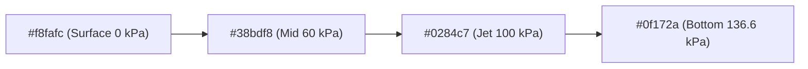

# BioFlo.in: Engineering Blueprint & Whiteprint Color System Standard

This specification defines the official **BioFlo.in Engineering Blueprint & Whiteprint Color Standard** for technical figures, publication plots, 3D CAD models, and WebGL visualizations across BioFlo platforms (`bioflo.in` and `workbench.bioflo.in`).

It draws direct inspiration from classical architectural and mechanical engineering drafting standards:
1. **Light Theme (Whiteprint / Blueline):** Clean drafting paper ground with deep royal blueprint ink, tailored for journal publications, technical blog articles, and clear presentation.
2. **Dark Theme (Cyanotype Blueprint):** Traditional deep Prussian/cyanotype blue ground with luminous drafting white and electric cyan linework, optimized for dark-mode UI and immersive 3D inspection.

---

## 1. Master Palette Specifications

### 1.1. Light Theme (Modern Whiteprint / Blueline)

| Visual Element | Color Name | Hex Code | RGB | Role & Usage Rules |
| :--- | :--- | :--- | :--- | :--- |
| **Canvas Background** | Drafting Paper White | `#f8fafc` | `(248, 250, 252)` | Master figure and container ground. Clean, zero glare. |
| **Subplot Background** | Pure Drafting White | `#ffffff` | `(255, 255, 255)` | Active 2D/3D plotting panes and viewport backgrounds. |
| **Drafting Grid** | Fine CAD Gridline | `#e2e8f0` | `(226, 232, 240)` | Millimeter coordinate grid lines (`linestyle=":"`, $\alpha = 0.9$). |
| **Master Contours / Text**| Deep Blueprint Navy | `#0f172a` | `(15, 23, 42)` | Primary headings, outer shell boundaries ($2.0\,\text{pt}$), OD lines. |
| **Drafting Dimensions** | Blueprint Royal Blue | `#0284c7` | `(2, 132, 199)` | Centerlines ($\mathbb{E}$), dimension arrows, leaders, liquid level lines. |
| **316L Stainless Shell** | Satin Polished Steel | `#e2e8f0` | `(226, 232, 240)` | Metallic vessel shell body with `#0284c7` royal blue wireframe edges. |
| **Dimple Cooling Jacket**| Light Cyan Wash | `#38bdf8` | `(56, 189, 248)` | Translucent jacket boundary ($\alpha = 0.20$) with blue dotted border. |
| **200L Broth Fluid** | Translucent Cyan Broth | `#38bdf8` | `(56, 189, 248)` | Aqueous culture fluid ($\alpha = 0.30$) with free surface meniscus. |
| **Wall Baffles (4x)** | Engineering Amber | `#d97706` | `(217, 119, 6)` | 4 vertical wall baffles and sanitary wall clearance gaps ($10\,\text{mm}$). |
| **Lower Rushton Turbine**| Technical Coral / Crimson | `#e11d48` | `(225, 29, 72)` | High-shear radial gas dispersion core at $Z = 0.35\,\text{m}$. |
| **Upper PBT 45° Turbine** | Ocean Blueprint Blue | `#0284c7` | `(2, 132, 199)` | $45^\circ$ down-pumping bulk axial circulation stage at $Z = 0.70\,\text{m}$. |
| **Central Drive Shaft** | Mechanical Slate | `#475569` | `(71, 85, 105)` | Solid $\phi 25\,\text{mm}$ drive shaft and sanitary bearings. |
| **Aeration Sparger** | Electric Blueprint Cyan | `#0284c7` | `(2, 132, 199)` | Bottom ring sparger tube and gas injection ports. |

---

### 1.2. Dark Theme (Traditional Cyanotype Blueprint)

| Visual Element | Color Name | Hex Code | RGB | Role & Usage Rules |
| :--- | :--- | :--- | :--- | :--- |
| **Canvas Background** | Deep Cyanotype Navy | `#06152b` | `(6, 21, 43)` | Traditional cyanotype drawing ground. |
| **Subplot Background** | Blueprint Cobalt | `#092243` | `(9, 34, 67)` | Technical elevation and section card container. |
| **Drafting Grid** | Blueprint Gridline | `#173e6b` | `(23, 62, 107)` | Coordinate grid overlay (`linestyle=":"`, $\alpha = 0.7$). |
| **Primary Dimensions / Titles**| Electric Blueprint Cyan | `#00f0ff` | `(0, 240, 255)` | Master dimensions, title blocks, leader arrows, $\mathbb{E}$. |
| **Outer Boundaries & Shaft** | Drafting Pure White | `#ffffff` | `(255, 255, 255)` | Outer shell contour, central drive shaft, and ASME flanges. |
| **316L Stainless Shell** | Blueprint Steel | `#103a68` | `(16, 58, 104)` | Polished metallic shell with luminous cyan wireframe edges (`#38bdf8`). |
| **Dimple Cooling Jacket**| Blueprint Cyan Wash | `#0284c7` | `(2, 132, 199)` | Translucent cooling jacket ($\alpha = 0.22$) with `#00f0ff` dotted boundary. |
| **200L Broth Fluid** | Bio-Fluid Indigo | `#0284c7` | `(2, 132, 199)` | Semi-transparent aqueous broth ($\alpha = 0.32$) with `#7dd3fc` meniscus. |
| **Wall Baffles (4x)** | Engineering Brass / Amber | `#f59e0b` | `(245, 158, 11)` | Vertical baffles with `#fef08a` highlights. |
| **Lower Rushton Turbine**| Signal Coral / Rose | `#f43f5e` | `(244, 63, 94)` | Radial gas dispersion core with `#fecdd3` highlights. |
| **Upper PBT 45° Turbine** | Electric Cyan Teal | `#06b6d4` | `(6, 182, 212)` | Axial blending turbine with `#a5f3fc` highlights. |
| **Sparger Ring** | Pure Electric Cyan | `#00f0ff` | `(0, 240, 255)` | Ring sparger lines ($2.0\,\text{pt}$). |

---

## 2. Continuous Scientific Blueprint Colormaps

To represent continuous physical scalar and vector fields (pressure, wall shear stress, turbulent kinetic energy, velocity magnitude) without non-physical rainbow distortions, use these three calibrated color ramps:

### 2.1. Wall Pressure Gradient (`bioflo_light_p` / `bioflo_bp_p`)
Maps hydrostatic pressure head from atmospheric surface datum down to maximum bottom dished head pressure:

- **Light Theme Ramp:** `#f8fafc` $\to$ `#bae6fd` $\to$ `#38bdf8` $\to$ `#0284c7` $\to$ `#1d4ed8` $\to$ `#0f172a`
- **Dark Theme Ramp:** `#071a30` $\to$ `#0c3b6b` $\to$ `#0284c7` $\to$ `#38bdf8` $\to$ `#bae6fd` $\to$ `#ffffff`



### 2.2. Wall Shear Stress & Impingement (`bioflo_light_tau` / `bioflo_bp_tau`)
Isolates localized high-shear radial impingement zones against calm boundary walls:

- **Light Theme Ramp:** `#f8fafc` $\to$ `#7dd3fc` $\to$ `#0284c7` $\to$ `#f59e0b` $\to$ `#e11d48` $\to$ `#881337`
- **Dark Theme Ramp:** `#071a30` $\to$ `#0284c7` $\to$ `#38bdf8` $\to$ `#f59e0b` $\to$ `#f43f5e` $\to$ `#ffffff`

### 2.3. Velocity Magnitude & Streamlines (`bioflo_light_jet` / `bioflo_bp_jet`)
Provides smooth, high-contrast velocity discharge visualization:

- **Light Theme Ramp:** `#f8fafc` $\to$ `#e0f2fe` $\to$ `#7dd3fc` $\to$ `#0284c7` $\to$ `#1e40af` $\to$ `#0f172a`
- **Dark Theme Ramp:** `#071a30` $\to$ `#09335e` $\to$ `#0284c7` $\to$ `#00f0ff` $\to$ `#a5f3fc` $\to$ `#ffffff`

---

## 3. Drop-in Python / Matplotlib Implementation

Copy and paste this module directly into any scientific plotting script:

```python
import matplotlib.pyplot as plt
from matplotlib.colors import LinearSegmentedColormap
import matplotlib.patches as patches

# =====================================================================
# 1. BioFlo.in Blueprint Colormaps
# =====================================================================
BIOFLO_LIGHT_PRESSURE = LinearSegmentedColormap.from_list(
    "bioflo_light_p", ["#f8fafc", "#bae6fd", "#38bdf8", "#0284c7", "#1d4ed8", "#0f172a"]
)

BIOFLO_LIGHT_SHEAR = LinearSegmentedColormap.from_list(
    "bioflo_light_tau", ["#f8fafc", "#7dd3fc", "#0284c7", "#f59e0b", "#e11d48", "#881337"]
)

BIOFLO_LIGHT_VELOCITY = LinearSegmentedColormap.from_list(
    "bioflo_light_jet", ["#f8fafc", "#e0f2fe", "#7dd3fc", "#0284c7", "#1e40af", "#0f172a"]
)

BIOFLO_DARK_PRESSURE = LinearSegmentedColormap.from_list(
    "bioflo_bp_p", ["#071a30", "#0c3b6b", "#0284c7", "#38bdf8", "#bae6fd", "#ffffff"]
)

BIOFLO_DARK_SHEAR = LinearSegmentedColormap.from_list(
    "bioflo_bp_tau", ["#071a30", "#0284c7", "#38bdf8", "#f59e0b", "#f43f5e", "#ffffff"]
)

# =====================================================================
# 2. Matplotlib Theme Activation
# =====================================================================
def set_bioflo_blueprint_theme(mode="light"):
    """Configures Matplotlib rcParams for BioFlo.in blueprint aesthetics."""
    if mode == "light":
        plt.style.use("default")
        plt.rcParams.update({
            "figure.facecolor": "#f8fafc",
            "axes.facecolor": "#ffffff",
            "axes.edgecolor": "#cbd5e1",
            "axes.labelcolor": "#0f172a",
            "text.color": "#0f172a",
            "xtick.color": "#0284c7",
            "ytick.color": "#0284c7",
            "grid.color": "#e2e8f0",
            "grid.linestyle": ":",
            "grid.alpha": 0.9,
            "font.family": "monospace",
        })
    else:
        plt.style.use("dark_background")
        plt.rcParams.update({
            "figure.facecolor": "#06152b",
            "axes.facecolor": "#092243",
            "axes.edgecolor": "#173e6b",
            "axes.labelcolor": "#7dd3fc",
            "text.color": "#f8fafc",
            "xtick.color": "#38bdf8",
            "ytick.color": "#38bdf8",
            "grid.color": "#173e6b",
            "grid.linestyle": ":",
            "grid.alpha": 0.7,
            "font.family": "monospace",
        })
```

---

## 4. Drop-in Three.js / WebGL PBR Materials

Use these calibrated Three.js materials in interactive 3D WebGL viewers:

```javascript
// =====================================================================
// BioFlo.in Light Theme (Whiteprint) PBR Materials
// =====================================================================
const matVesselSteel = new THREE.MeshStandardMaterial({
  color: 0xe2e8f0,
  metalness: 0.65,
  roughness: 0.30,
  side: THREE.DoubleSide
});

const matCoolingJacket = new THREE.MeshPhysicalMaterial({
  color: 0x38bdf8,
  transmission: 0.85,
  opacity: 0.25,
  roughness: 0.15,
  side: THREE.DoubleSide
});

const matBrothFluid = new THREE.MeshPhysicalMaterial({
  color: 0x38bdf8,
  transmission: 0.82,
  opacity: 0.90,
  roughness: 0.10,
  ior: 1.333,
  side: THREE.DoubleSide
});

const matWallBaffles = new THREE.MeshStandardMaterial({
  color: 0xd97706,
  metalness: 0.70,
  roughness: 0.35,
  side: THREE.DoubleSide
});

const matRushtonTurbine = new THREE.MeshStandardMaterial({
  color: 0xe11d48,
  metalness: 0.85,
  roughness: 0.25,
  side: THREE.DoubleSide
});

const matPBTTurbine = new THREE.MeshStandardMaterial({
  color: 0x0284c7,
  metalness: 0.85,
  roughness: 0.25,
  side: THREE.DoubleSide
});

const matDriveShaft = new THREE.MeshStandardMaterial({
  color: 0x475569,
  metalness: 0.75,
  roughness: 0.25
});
```

---

## 5. Web & CSS Tokens (`:root`)

For front-end web applications on `workbench.bioflo.in`:

```css
:root {
  /* Light Theme (Whiteprint) */
  --bioflo-canvas-bg: #f8fafc;
  --bioflo-panel-bg: #ffffff;
  --bioflo-grid-line: #e2e8f0;
  --bioflo-navy-text: #0f172a;
  --bioflo-blueprint-blue: #0284c7;
  --bioflo-dimple-cyan: #38bdf8;
  --bioflo-baffle-amber: #d97706;
  --bioflo-rushton-coral: #e11d48;
  --bioflo-pbt-blue: #0284c7;
  --bioflo-shaft-slate: #475569;
}

[data-theme="dark"] {
  /* Dark Theme (Cyanotype) */
  --bioflo-canvas-bg: #06152b;
  --bioflo-panel-bg: #092243;
  --bioflo-grid-line: #173e6b;
  --bioflo-navy-text: #f8fafc;
  --bioflo-blueprint-blue: #00f0ff;
  --bioflo-dimple-cyan: #0284c7;
  --bioflo-baffle-amber: #f59e0b;
  --bioflo-rushton-coral: #f43f5e;
  --bioflo-pbt-blue: #06b6d4;
  --bioflo-shaft-slate: #f8fafc;
}
```

---

## 6. Official ASME BPE Blueprint Title Block Format

Whenever preparing publication drawings or full-page engineering schematics, reserve the lower right quadrant for the standard engineering title block:

```text
┌────────────────────────────────────────────────────────────────────────┐
│ PROJECT: BIOFLO.IN WORKBENCH                                           │
│ ITEM:    200L CSTR PILOT BIOREACTOR ENGINEERING BLUEPRINT              │
│ CODE:    ASME BPE 2024 / DIN 1.4404 (316L SS)     SCALE: 1:10 (METRIC)│
│ DWG NO:  BF-CSTR-200L-REV2.3                      STATUS: VERIFIED CFD │
├────────────────────────────────────────────────────────────────────────┤
│ Working Vol: 200.0 L (H_L=1000mm) │ Agitation: 300 RPM (v_tip=2.62m/s) │
│ Tank Bore:   Ø 500 mm ID          │ Bottom Head: ASME Torispherical    │
│ Wall Shell:  t_w = 6.0 mm         │ Lower Stage: 6-Blade Rushton       │
│ Headspace:   27.7% (V_tot=255.4L) │ Upper Stage: 4-Blade PBT 45°       │
└────────────────────────────────────────────────────────────────────────┘
```
