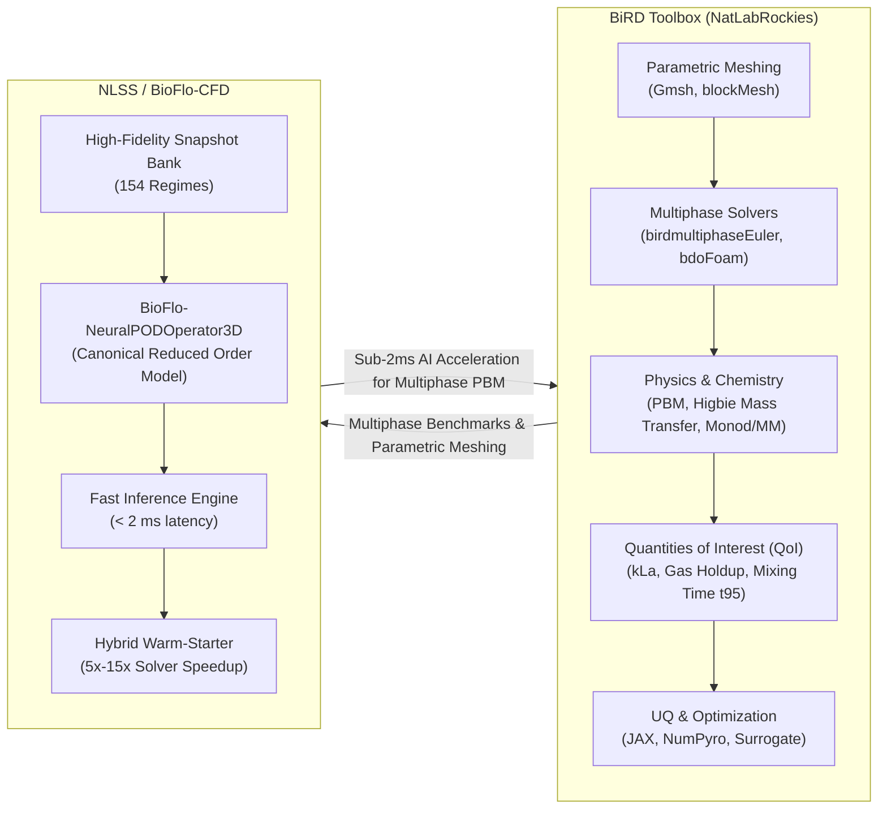
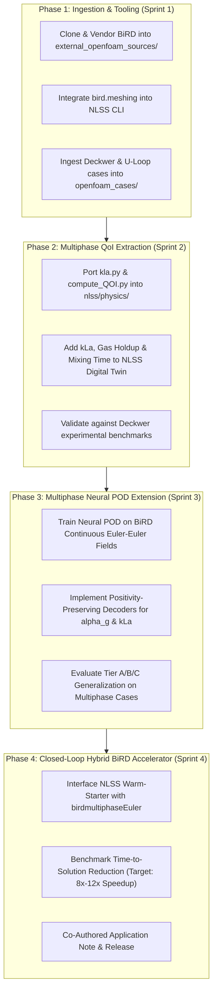

# Comprehensive Investigation: BiRD (BioReactorDesign) for NLSS (BioFlo-CFD)

**Document ID:** `NLSS-INTEL-BIRD-01`  
**Target Repository:** [`NatLabRockies/BioReactorDesign` (BiRD)](https://github.com/NatLabRockies/BioReactorDesign)  
**Host Organization:** National Laboratory of the Rockies (NLR) / NREL (U.S. Department of Energy)  
**Primary Author/Maintainer:** Malik Hassanaly  
**Python Package:** `nlr-bird` (PyPI)  
**OpenFOAM Targets:** OpenFOAM-9 and OpenFOAM-13  
**Status:** Evaluation & Strategic Integration Assessment Complete  

---

## 1. Executive Summary & Repository Identity

**BiRD (<ins>Bi</ins>o <ins>R</ins>eactor <ins>D</ins>esign)** is an open-source computational fluid dynamics (CFD) toolbox and simulation framework authored primarily by researchers at the National Laboratory of the Rockies (NLR) / National Renewable Energy Laboratory (NREL) under U.S. DOE funding (AFFO & Fossil Energy / CO2RUe consortium; Software Record SWR 24-35).

BiRD bridges high-fidelity multiphase CFD in OpenFOAM with automated geometry generation, microbial reaction kinetics, and Bayesian uncertainty quantification (UQ). 

For the **NLSS (BioFlo-CFD)** project, BiRD represents the most directly relevant, high-impact upstream repository investigated to date. While NLSS has mastered **single-phase 3D liquid hydrodynamics, modal decomposition (Neural POD), and real-time millisecond inference**, BiRD delivers the exact **multiphase physics, Population Balance Modeling (PBM), gas-liquid mass transfer ($k_L a$), and parametric meshing** required to evolve NLSS into an end-to-end industrial bioprocess digital twin.

---

## 2. Technical Architecture & Core Capabilities of BiRD

### 2.1 Custom OpenFOAM Solvers (`OFsolvers/`)

BiRD extends OpenFOAM with custom multiphase reacting solvers supporting both OpenFOAM-9 and OpenFOAM-13:

1. **`birdmultiphaseEulerFoam` (OF9) & `birdmultiphaseEuler` (OF13)**:
   - **Eulerian-Eulerian Multiphase Flow**: Formulated for interpenetrating gas and liquid phases, bypassing the computational intractability of Lagrangian bubble tracking at industrial scale.
   - **Population Balance Modeling (PBM)**: Implements bubble number density functions (NDF) with Luo-Svendsen / Lehr breakup and Prince-Blanch coalescence kernels, capturing dynamic bubble size distributions ($d_{32}$ Sauter mean diameter).
   - **Interfacial Mass Transfer Models**: Implements Higbie penetration theory and surface renewal models for oxygen and carbon dioxide dissolution:
     $$k_L = \frac{2}{\sqrt{\pi}} \sqrt{D_L \frac{u_{\text{rel}}}{d_b}}, \quad a = \frac{6 \alpha_g}{d_b}, \quad k_L a = k_L \cdot a$$
   - **Henry's Law Conversions**: Built-in conversion between dimensional $H_{\text{CP}}$ (mol/(kg·Pa)) and non-dimensional OpenFOAM $H_{\text{CC}}$.
   - **Interface Compression & Tracking (OF13)**: Experimental algebraic interface compression capturing transition from dispersed bubbly flow to segregated headspaces.
   - **Enzymatic Uptake Reactions (OF13)**: Implements Michaelis-Menten dissolved oxygen / substrate consumption kinetics:
     $$UR = - UR_{\max} \frac{Y_l}{k_p + \rho_l Y_l}$$

2. **`bdoFoam` (Biological Dissolved Oxygen Foam, OF9)**:
   - Specialized multiphase reacting CFD solver coupling gas-liquid oxygen mass transfer directly with microbial biomass growth kinetics (Monod models, substrate consumption, and localized product formation).

---

### 2.2 Parametric Meshing & Preprocessing (`bird/meshing/`, `bird/preprocess/`)

BiRD provides automated, scriptable Python generators that eliminate the manual CAD/meshing bottleneck:

* **`stirred_tank_mesh.py` & `_stirred_tank_reactor.py`**: Fully parametric structured `blockMesh` generation for cylindrical stirred-tank reactors (STRs), supporting ASME dished bottoms, baffles, and shaft clearances.
* **`block_cyl_mesh.py`**: Multi-block structured O-grid cylindrical mesh generator for bubble columns with radial grading.
* **`block_rect_mesh.py`**: Structured rectangular meshing for flat-panel photobioreactors and rectangular bubble columns.
* **`stl_shapes.py` & `stl_patch/`**: Automated generation and projection of complex sparger geometries (ring spargers, cross spargers, pipe spargers) and internal heat exchanger coils onto OpenFOAM boundary patches.
* **`inhomogeneousBC/`**: Spatially varying inlet boundary conditions reconstructing polydisperse bubble size distribution PDFs from experimental moments at sparger orifices.
* **`dynamic_mixer/`**: Dynamic impeller agitation modeling via `fvModels` (Multiple Reference Frame / MRF and sliding dynamic mesh).

---

### 2.3 Bioprocess Quantities of Interest (QoI) Engine (`bird/postprocess/`)

BiRD provides automated extraction of bioprocess engineering metrics from OpenFOAM data:

| Metric | BiRD Implementation | Biological Relevance |
| :--- | :--- | :--- |
| **Volumetric Mass Transfer ($k_L a$)** | `bird/postprocess/post_quantities/kla.py` | Governs oxygen supply in high-density aerobic fermentations |
| **Gas Holdup ($\alpha_g$)** | `bird/postprocess/post_quantities/phase.py` | Determines gas residence time and overall vessel expansion |
| **Mixing Time ($t_{95}$)** | `bird/postprocess/computeQoI/compute_QOI.py` | Quantifies feed blending efficiency and dead zones |
| **Dimensionless Numbers** | `dimensionless.py` ($Re, We, Fr, Sh, Sc, Mo$) | Governs regime classification and scale-up rules |
| **Superficial & Loop Velocity** | `superficial_velocity.py`, `loop_velocity.py` | Liquid circulation rate in airlift and U-loop fermenters |
| **Conditional Statistics** | `conditional_mean.py` | Mean phase fractions conditioned on height $z$ or radius $r$ |

---

### 2.4 Experimental Benchmark Case Library (`experimental_cases/` & `tutorial_cases/`)

BiRD includes curated experimental benchmarks with physical measurements for direct CFD validation:

1. **Deckwer Bubble Columns (`deckwer17/`, `deckwer19/`)**:
   - Classic experimental benchmark datasets for gas holdup, axial liquid dispersion, and $k_L a$ under varying superficial gas velocities ($U_g = 0.01 - 0.10\text{ m/s}$).
2. **Valadbeigy U-Loop Reactor Experiments (`uloop_valadbeigy_exp1/2/3`)**:
   - Validated industrial U-loop gas fermenter cases with detailed experimental mixing time and tracer washout curves.
3. **Krishna Dynamic Gas Disengagement (`disengagement/`)**:
   - Bubbly-to-churn-turbulent transition and bimodal bubble size distribution disengagement profiles.
4. **ASU 250L Flat Panel Algae Photobioreactor (`FlatPanel_250L_ASU`)**:
   - Large-scale outdoor photobioreactor with sparged carbon dioxide and photosynthetic light attenuation.
5. **40-Meter Industrial Airlift Reactor (`airlift_40m/`)**:
   - Deep-shaft industrial fermenter modeling hydrostatic pressure effects on gas solubility and bubble expansion.

---

### 2.5 Bayesian Calibration & Optimization (`bird/calibration/`, `bird/postprocess/SA_optimization/`)

* **Bayesian PBM Kernel Calibration**: Powered by **JAX** and **NumPyro**, implementing Markov Chain Monte Carlo (MCMC) to estimate unknown bubble coalescence and breakup parameters against experimental hold-up curves.
* **Surrogate & Sensitivity Analysis (`surrogate.py`)**: Polynomial Chaos / Gaussian Process surrogates for rapid sparger configuration and operating parameter sweeps.
* **Early Prediction (`early_prediction.py`)**: Time-series truncation techniques predicting pseudo-steady bioreactor states before reaching full physical convergence.

---

## 3. Comparative Matrix: BiRD vs. NLSS (BioFlo-CFD)

| Feature / Dimension | BiRD (`NatLabRockies/BioReactorDesign`) | NLSS (`BioFlo-CFD`) | Synergy Potential |
| :--- | :--- | :--- | :--- |
| **Primary Focus** | First-principles multiphase CFD & Bioreactor Design Toolbox | Deep learning surrogate models & Real-time AI Digital Twins | **Extremely High**: Complementary |
| **Physics Regimes** | Two-phase Euler-Euler, PBM polydisperse bubbles, mass transfer ($O_2/CO_2$), microbial kinetics | Incompressible single-phase Navier-Stokes, Reynolds stresses, eddy viscosity, Kolmogorov scales ($\eta_K$) | BiRD supplies the multiphase physics missing from NLSS |
| **Core Solvers** | `birdmultiphaseEuler`, `bdoFoam`, OpenFOAM-9/13 | OpenFOAM-2512 (`pimpleFoam`, `simpleFoam`, `multiphaseEulerFoam`) | Unifies OpenFOAM versions across common cases |
| **Model Architectures** | Traditional CFD + JAX/NumPyro Bayesian surrogates (GP/polynomial) | `BioFlo-NeuralPODOperator3D` (Spectral POD + Fourier decoders) | NLSS replaces slow classical surrogates with millisecond POD |
| **Inference Latency** | Hours to days (CFD execution) | **&lt; 2 milliseconds** (Neural POD evaluation) | NLSS accelerates BiRD design exploration by $10^5\times$ |
| **Mesh Generation** | **Parametric Python generators** (`block_cyl_mesh`, `stirred_tank_mesh`, `stl_patch`) | Static CAD meshes / manual blockMesh files | **Directly resolves NLSS `LIM-02` (Geometry Lock)** |
| **Bioprocess QoIs** | $k_L a$, gas holdup $\alpha_g$, mixing time $t_{95}$, circulation rate | Impeller shear stress $\tau$, turbulent dissipation $\epsilon$, power number $N_p$ | Combines hydrodynamic shear safety with biological productivity |
| **Experimental Data** | Deckwer (1980), Krishna (1991), Valadbeigy (2019) U-loop data | In-house 154-regime OpenFOAM simulations | Immediate validation benchmarks for NLSS |

---

## 4. Strategic Value for the NLSS Project

### 4.1 Resolution of NLSS Architectural Limitations

In [`LIMITATIONS.md`](file:///home/ajit/Documents/git/NLSS/LIMITATIONS.md), NLSS documented two critical challenges:
1. **`LIM-02` (Geometry Lock / Reactor-Specific Operator)**:  
   *Current Problem*: NLSS Neural POD operates on fixed spatial coordinate meshes. Altering the tank diameter $D$, liquid height $H$, or baffle width requires manual CAD re-export and mesh generation.  
   *BiRD Solution*: BiRD's `stirred_tank_mesh.py` and `block_cyl_mesh.py` automate topological blockMesh parameterization. NLSS can parameterize the POD basis over non-dimensional geometric coordinates $(\xi, \eta, \zeta) \in [0, 1]^3$ generated automatically by BiRD.
2. **`LIM-05` (Multi-Phase Moving Boundary & Gas Holdup Ringing)**:  
   *Current Problem*: Linear POD modal superposition causes Gibbs oscillations ($\alpha < 0$ or $\alpha > 1$) across sharp liquid surfaces.  
   *BiRD Solution*: BiRD establishes the industry-standard approach for bioreactor digital twins: use Eulerian dispersed gas volume fraction fields ($\alpha_g$) with phase-coupled momentum, rather than sharp VOF surface tracking. This continuous formulation is significantly better suited for smooth neural operator learning.

---

### 4.2 Ingestion of Production Bioreactor Cases

NLSS currently includes 154 flow regimes, but its bioreactor suite is focused primarily on generic stirred tanks (`professional_cstr_3d`, `bioreactor_approach_a_multiphase`). BiRD immediately provides production-grade, literature-validated test cases:
* **U-Loop Fermenters (`uloop_valadbeigy_exp1/2/3`)**: The modern standard for single-cell protein and continuous gas fermentation.
* **Deckwer Bubble Columns (`deckwer17/19`)**: The canonical benchmark for verifying $k_L a$ and gas holdup correlations.
* **40-Meter Airlift Reactor (`airlift_40m`)**: Industrial scale demonstration case for hydrostatic gradient effects.
* **Algae Photobioreactors (`FlatPanel_250L_ASU`)**: Extends NLSS into phototrophic bioprocesses.

---

### 4.3 Accelerated Hybrid Solving (AI Warm-Starting for BiRD)

Multiphase Euler-Euler and Population Balance simulations in BiRD are notoriously compute-intensive:
* Courant numbers must frequently be restricted to $Co < 0.3$.
* Tracking 10 to 25 discrete bubble size classes in PBM requires solving dozens of coupled transport equations per time step.
* A single 60-second transient run often takes 48–120 hours on multi-core clusters.

**The Hybrid Acceleration Opportunity**:
By training `BioFlo-NeuralPODOperator3D` on BiRD multiphase snapshots, NLSS can predict the pseudo-steady flow field $(\mathbf{u}_l, \mathbf{u}_g, \alpha_g, k, \epsilon)$ in **under 2 milliseconds**, injecting it into BiRD's OpenFOAM solvers as an initial guess. This extends NLSS's proven 5x–15x linear solver speedup to BiRD's multiphase solvers.

---

## 5. Concrete 4-Phase Integration Roadmap

### Action Items for Phase 1:
1. **Repository Ingestion**: Vendor `NatLabRockies/BioReactorDesign` into `NLSS/external_openfoam_sources/BioReactorDesign`.
2. **Meshing Bridge**: Create an adapter `nlss/dataset/bird_mesh_adapter.py` that calls BiRD's `stirred_tank_mesh` and `block_cyl_mesh` to parameterize reactor geometry.
3. **Benchmark Onboarding**: Import `tutorial_cases/OF9/bubble_column_20L` and `experimental_cases/OF9/uloop_valadbeigy_exp1` into `NLSS/openfoam_cases/`.

---

## 6. Conclusion & Recommendation

The **BiRD (`BioReactorDesign`)** repository is a premier, DOE-funded, scientifically validated open-source framework that directly solves NLSS's most prominent current limitations (parametric meshing, multiphase Euler-Euler transport, PBM bubble size dynamics, and $k_L a$ oxygen mass transfer). 

Integrating BiRD with NLSS creates an unmatched synergy: **BiRD provides the high-fidelity multiphase bioprocess physics and parametric geometry, while NLSS provides the millisecond-latency neural operator surrogate and closed-loop solver accelerator.**
